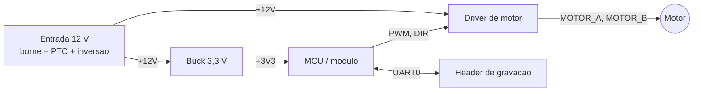

# {{placa}} · Diagrama de blocos

Fonte KiCad: `hardware/{{placa}}/`. Modo do esquematico: **spec** (ver README da placa).

## Requisitos resumidos

| Item | Valor | Origem |
|---|---|---|
| Entrada de alimentacao | V min / V max, conector | |
| Tensao maxima na placa | V (acima de 60 V DC ou rede = alta tensao) | |
| Consumo tipico / pico | | |
| Interfaces externas | | |
| Ambiente | temperatura, IP, vibracao | |
| Mecanica | dimensao maxima, furos, caixa | |
| Montagem | JLCPCB SMT / manual | |
| Volume e custo alvo | | |
| Certificacao | Anatel / outra / nenhuma | |

## Blocos

Troque o exemplo pelos blocos reais. Uma seta por trilho de alimentacao (com tensao) e por grupo de
sinais (com o nome da rede ou barramento).

## Orcamento de potencia

| Trilho | Consumidor | I tipica (mA) | I pico (mA) | Observacao |
|---|---|---|---|---|
| +3V3 | | | | |
| **Total +3V3** | | | | margem >= 30% sobre o pico |

| Regulador | Vin | Vout | I max | Dissipacao | Escolha |
|---|---|---|---|---|---|
| | | | | (Vin - Vout) x I para linear; (1 - eficiencia) x Pout para buck | |

## Decisoes

- Numero de camadas e motivo:
- MCU / modulo e motivo:
- ADRs relacionadas:
